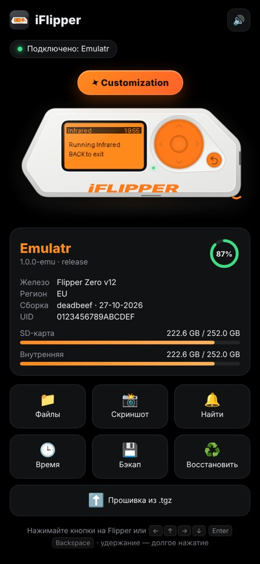
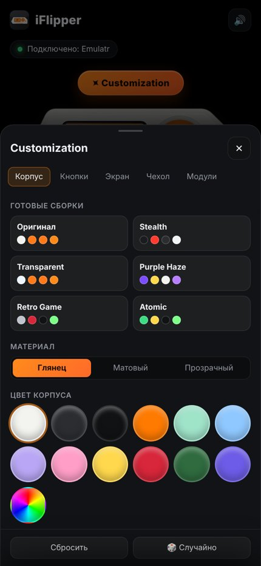
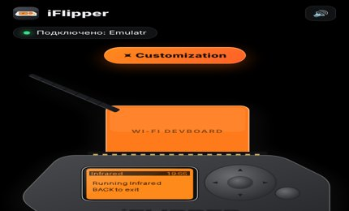
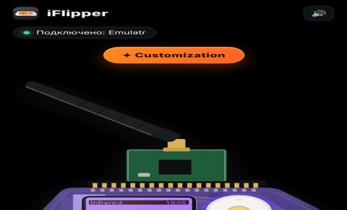

<p align="center"></p>

# iFlipper

Компаньон для **Flipper Zero**: приложение с «живым» Flipper, CLI и Python API. Всё, что умеет qFlipper, и то, чего он не умеет.

<p align="center">
  &nbsp;&nbsp;
</p>

Приложение в стиле мобильного: чёрный фон, сверху ваш Flipper. Подключаете его по USB — он появляется на экране,
окно само выскакивает поверх остальных. Экран живой (то, что сейчас на вашем Flipper), кнопки нажимаются прямо на
рисунке мышью или пальцем, а также стрелками/Enter/Backspace; удержание — долгое нажатие.

Рисунок Flipper сделан с нуля в SVG по пропорциям настоящего устройства. Фото, логотип и дельфин Flipper Devices
не используются — это их товарный знак и арт.

**Customization** (кнопка над Flipper):

- **Корпус** — глянец, мат или прозрачный пластик (видно плату, батарею, катушку антенны), 12+ цветов и любой свой, цвет надписи; готовые сборки.
- **Кнопки** — крестовина, OK и «Назад» отдельно; наборы.
- **Экран** — цвет подсветки.
- **Чехол** — половинка (бампер по краю и нижняя часть под экраном и кнопками) или полный (открыт только экран, кнопки — силиконовые накладки, нажимаются как обычно); цветной силикон или прозрачный TPU с оттенком.
- **Модули в GPIO** — Wi-Fi Devboard (ESP32-S2), CC1101, NRF24 + PA/LNA, Game Module: у каждого крышка вкл/выкл (цветная или прозрачная) и антенна вкл/выкл, где есть разъём.

Внешний вид запоминается между запусками.

| Полный чехол + Wi-Fi Devboard | Прозрачный корпус + CC1101 |
|---|---|
|  |  |

| | qFlipper | iFlipper |
|---|:-:|:-:|
| Инфо об устройстве, батарея, память | ✓ | ✓ |
| Файловый менеджер | ✓ | ✓ приложение, CLI, TUI |
| Обновление прошивки (официальные каналы) | ✓ | ✓ `update` |
| Кастомные прошивки (Unleashed, Momentum, …) из .tgz/URL | ~ | ✓ |
| Бэкап / восстановление | только `/int` | **вся флешка**, `.tar.gz`, инкрементально (`--since`) |
| Восстановление только изменённого / одной папки | ✗ | ✓ `restore --only /ext/nfc` |
| Синхронизация папок (как rsync, по MD5) | ✗ | ✓ `sync push/pull --delete --dry-run` |
| Стрим экрана + управление кнопками | ✓ | ✓ в приложении и в терминале |
| Кастомизация внешнего вида, чехлы, модули | ✗ | ✓ |
| Макросы кнопок | ✗ | ✓ `press down down ok` |
| Python API / REPL / скрипты | ✗ | ✓ `shell`, `import iflipper` |
| Подключение по сети (TCP) | ✗ | ✓ `-p tcp://host:port` |
| Виртуальный Flipper без железа | ✗ | ✓ `emulate` |

## Установка

### Windows

Скачайте из [Releases](https://github.com/kl1ns2/iFlipper/releases) (или из артефакта **iFlipper-windows** последней сборки во вкладке **Actions → build**):

- **`iFlipper-Setup.exe`** — установщик. Ставит программу только для текущего пользователя, поэтому **не просит прав
  администратора**; создаёт ярлыки и деинсталлятор.
- **`iFlipper-portable.zip`** — то же без установки: распаковать и запустить `iFlipper.exe`.

Внутри два файла: `iFlipper.exe` (приложение) и `iflipper-cli.exe` (командная строка). Нужен Windows 10/11 —
окно рисуется встроенным в Windows движком WebView2 (Edge). Если его нет, приложение откроется в браузере.

#### Про «Windows защитила ваш компьютер» / «Неизвестный издатель»

Это SmartScreen. Он показывает предупреждение для любого **неподписанного** exe, который скачали из интернета, —
независимо от того, что внутри. Убрать его можно только честно:

1. **Подписать сборку сертификатом подписи кода.** CI уже умеет: добавьте в репозиторий секреты
   `SIGN_PFX_BASE64` (base64 от `.pfx`) и `SIGN_PFX_PASSWORD` — exe и установщик подпишутся автоматически.
   Недорогой вариант для open-source — сертификат Certum Open Source Code Signing. Подписанная программа
   сначала тоже может показывать предупреждение, пока у сертификата не наберётся репутация.
2. **Microsoft Store** — приложения из Store подписывает Microsoft, SmartScreen их не трогает.
3. **winget** — установка через `winget install` не вызывает SmartScreen.

Пока сборка не подписана: «Подробнее» → «Выполнить в любом случае». Обходить SmartScreen или антивирус
другими способами мы не будем.

### Из исходников (Windows / macOS / Linux)

```bash
pip install -e .          # Python 3.10+
iflipper gui              # приложение
iflipper --help           # CLI
```

Собрать Windows-сборку самостоятельно:

```bash
pip install -e ".[build]"
pyinstaller packaging/iflipper.spec      # → dist/iFlipper/ (iFlipper.exe + iflipper-cli.exe)
iscc packaging/installer.iss             # → dist/iFlipper-Setup.exe (Inno Setup 6)
```

Linux: если нет доступа к порту — добавьте себя в группу `dialout` (`sudo usermod -aG dialout $USER`).

## Примеры

```bash
iflipper info                               # имя, прошивка, батарея, память
iflipper tui                                # полноэкранный дашборд: файлы, живой экран, лог
iflipper ls -l /ext/subghz
iflipper push garage.sub /ext/subghz        # загрузка с прогресс-баром
iflipper pull /ext/nfc ./nfc-dump           # скачать папку целиком
iflipper sync push ./my-badusb /ext/badusb --delete -n   # посмотреть, что изменится
iflipper backup                             # → Name-YYYYmmdd-HHMMSS.tar.gz
iflipper backup --since old.tar.gz          # не качать заново неизменённые файлы
iflipper restore backup.tar.gz --only /ext/nfc
iflipper update --check                     # доступные версии
iflipper update --channel rc
iflipper update --file ./unleashed-f7-update.tgz
iflipper screenshot                         # PNG
iflipper screenshot --text                  # прямо в терминал
iflipper press down down ok                 # макрос кнопок
iflipper app start "Sub-GHz" /ext/subghz/door.sub
iflipper time --sync                        # выставить часы
iflipper alert                              # найти «свой» флиппер: мигнёт, пискнет, вибрирует
```

Несколько флипперов: `iflipper devices`, затем `-p /dev/ttyACM1` (или `IFLIPPER_PORT`).

### TUI

`iflipper tui`: слева — устройство, батарея, заполненность SD/внутренней памяти, прогресс передачи.
**F1** файлы (`d` скачать, `u` загрузить, `n` папка, `Del` удалить, `r` обновить),
**F2** живой экран (стрелки, `Enter` = OK, `Backspace` = Back, `s` скриншот), **F3** лог.

### Python API

```python
from iflipper import Flipper

with Flipper.connect() as f:          # или Flipper.connect("tcp://127.0.0.1:7777")
    print(f.info()["firmware_version"])
    for top, dirs, files in f.walk("/ext/nfc"):
        print(top, [x.name for x in files])
    f.write("/ext/infrared/tv.ir", open("tv.ir", "rb").read())
    f.press("ok")
    png = f.screenshot()
```

`iflipper shell` открывает REPL с уже подключённым `f`; `iflipper shell script.py` выполняет скрипт.

### Виртуальный Flipper

```bash
iflipper emulate --pty            # создаёт /dev/pts/N — работает как настоящий USB-порт
iflipper emulate --tcp 7777       # iflipper -p tcp://127.0.0.1:7777 tui
```

Эмулятор говорит на настоящем RPC-протоколе: файловая система (`/ext`, `/int` — реальные папки на диске),
экран с меню, кнопки, приложения, часы, установка обновлений. Его используют тесты, и он удобен для разработки.

## Как это устроено

- `src/iflipper/rpc.py` — RPC поверх CLI Flipper: `start_rpc_session`, varint-кадры `PB.Main`, мультиплексирование по `command_id`, стриминг `has_next`.
- `src/iflipper/device.py` — высокоуровневый API (`Flipper`).
- `src/iflipper/sync.py`, `backup.py`, `update.py` — синхронизация, бэкапы, прошивки.
- `src/iflipper/gui.py` — нативное окно (pywebview/WebView2), всплывает при подключении Flipper.
- `src/iflipper/server.py`, `link.py` — локальный бэкенд для интерфейса (127.0.0.1 + токен) и автоподключение/переподключение.
- `src/iflipper/web/` — интерфейс без внешних библиотек, работает офлайн: сцена (`stage.js`), Flipper, чехлы и модули в SVG и экран (`device.js`), Customization (`custom.js`).
- `src/iflipper/cli.py`, `tui.py` — интерфейсы (click + rich, textual).
- `packaging/` — сборка (PyInstaller), установщик (Inno Setup), иконка (`render_icon.py` рендерит её из того же рисунка); `.github/workflows/build.yml` — CI: тесты, Windows-сборка, подпись (если есть сертификат).
- `src/iflipper/emulator.py` — виртуальный Flipper.
- `proto/` — схемы [flipperzero-protobuf](https://github.com/flipperdevices/flipperzero-protobuf); биндинги пересобираются `scripts/gen_proto.sh`.

## Разработка

```bash
pip install -e '.[dev]'
pytest
```
